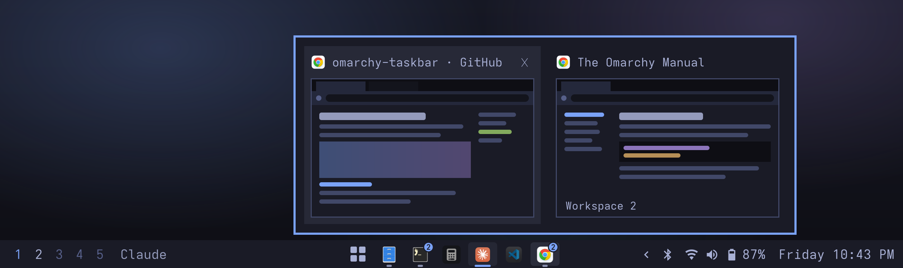

# Taskbar for Omarchy

A Windows-style taskbar that lives **inside the Omarchy bar**. Pinned apps and
running apps sit side by side, so you get a dock without adding a second bar.

<p align="center"></p>

## Features

- **Pinned and running apps** in one row. Pinned apps stay put; running apps join at the end.
- **Click to switch.** Click an app to open it or focus it. Click again to cycle its windows. Click the focused app to minimize it, like Windows.
- **Live window previews** on hover. Click one to switch to it, or ✕ / middle-click to close it.
- **Jump lists** on right-click: every window, new window, pin/unpin, move left/right, move to this workspace, minimize/restore, close / close all.
- **Drag to reorder.** Pinned order is saved, and a drag can't knock Taskbar off the bar.
- **No cursor jump.** Hyprland normally warps the pointer onto a window it focuses. Taskbar switches that off for the instant of the click, so your mouse stays where you clicked.
- **Status at a glance:** a short line under running apps, a long accent line under the focused one, a window-count badge, red for apps that want attention, and a pulse while an app starts.
- **Apps button (⊞):** left-click opens the app grid, right-click opens Taskbar settings.
- **Scriptable:** activate, launch, pin and unpin apps from keybindings or scripts.
- Follows your Omarchy theme, and works on top, bottom, left and right bars.

## Install

```bash
omarchy plugin add https://github.com/0xEsmail/omarchy-taskbar.git --enable
```

Or from a clone:

```bash
git clone https://github.com/0xEsmail/omarchy-taskbar.git
cd omarchy-taskbar && ./install.sh
```

`install.sh` also pins the apps your dock pins. Run it again after editing
the files to load your changes.

## Uninstall

```bash
~/.config/omarchy/plugins/0xesmail.taskbar/uninstall.sh
```

This removes Taskbar and can **put your bar back the way it was** before
this installation set up the Windows layout. It asks first, because bar
changes you made since installing would be undone:

| Answer or option | What happens |
|---|---|
| Enter, `y`, or `--yes` | Bar restored, Taskbar removed |
| `n`, or `--keep-layout` | Bar left as it is, Taskbar removed |
| No terminal to ask in, no answer, or an unclear answer | **Nothing changes.** Run again with `--yes` or `--keep-layout` |

Only the bar saved by the installation you're removing is ever restored. A
reinstall saves your bar afresh, so uninstalling never brings back a layout
from an earlier installation. If the bar can't be saved when Taskbar first
loads, Taskbar leaves your layout untouched instead of changing it without a
way back.

Use this rather than `omarchy plugin remove`, which only deletes the files
and can't restore your bar.

### Windows layout, set up for you

The first time Taskbar loads, it sets your bar up Windows 11 style:

- the bar moves to the **bottom**
- Taskbar goes in the **center**, icons only
- the **clock** goes to the bottom-right corner
- widgets that sat around the clock move to the right side
- the indicator icons stay visible instead of showing only on hover

This happens **once** per installation. Before it changes anything, Taskbar
saves your bar as it was to `~/.local/state/0xesmail.taskbar/bar-before-layout.json`,
so uninstalling can put it back. `shell.json` is also backed up
(`shell.json.bak.<time>`). After that Taskbar never moves anything on its
own, so you can rearrange freely.

- **Keep your current layout:** install with `./install.sh --keep-layout`, or
  turn off **Windows layout on first run** in Taskbar's settings.
- **Apply it again later:** right-click ⊞ → **Apply Windows layout**, or run
  `./setup-layout.sh --force`.
- **Undo it:** uninstall (below), which puts the bar back for you.
  `./setup-layout.sh --restore` does just the bar part: your old bar comes
  back, without Taskbar on it.

Taskbar is a widget, and widgets can't rearrange the bar directly, so
`setup-layout.sh` does it with Omarchy's own `omarchy bar` commands.

## Using it

| Action | What happens |
|---|---|
| **Click** an app | Not running: launch it. Running: focus it, or cycle its windows. Already focused: minimize it |
| **Middle-click** or **Shift+click** | Open a new window |
| **Right-click** | Jump list: windows, new window, pin/unpin, move left/right, move here, minimize/restore, close |
| **Drag** an app | Reorder: drop it where the accent line shows (left or right button) |
| **Hover** | Live previews of the app's windows |
| **Scroll** over an app | Cycle through its windows |
| **⊞ button** | Left-click: app grid. Right-click: settings |

**Dragging icons.** The Omarchy bar normally treats a drag on any widget as
moving the whole widget, and dragging it off the bar removes it. Taskbar
keeps drags on its icons for itself, so dragging reorders apps, and the
taskbar can't be dragged off the bar by accident. To move Taskbar to another
part of the bar, use `omarchy bar move 0xesmail.taskbar --section <left|center|right>`.
**Move left / Move right** in the right-click menu also reorder apps.

If a future Omarchy changes how the bar handles drags, left-dragging may
move the whole widget again; right-drag still reorders apps then. If Taskbar
ever ends up off the bar, re-run `./install.sh` or
`omarchy plugin enable 0xesmail.taskbar`.

Minimized windows go to the same `special:minimized` workspace as Omarchy's
dock, and come back to the workspace you're on.

## Settings

Change these from the ⊞ right-click menu, with `omarchy bar set 0xesmail.taskbar <key> <value>`,
or on the `0xesmail.taskbar` entry in `~/.config/omarchy/shell.json`:

| Key | Default | Meaning |
|---|---|---|
| `pinned` | `[]` | Desktop ids, in order |
| `labels` | `"focused"` | Titles next to icons: `"none"`, `"focused"` (focused app only), `"all"` |
| `maxLabelWidth` | `180` | Longest title, in pixels |
| `filter` | `"all"` | Which windows to list: `"all"`, `"monitor"` (this monitor), `"workspace"` (visible workspace) |
| `clickToMinimize` | `true` | Clicking the focused app minimizes it |
| `previews` | `true` | Live thumbnails on hover |
| `showAppsButton` | `true` | Show the ⊞ button |
| `appsCommand` | `omarchy-shell omarchy.dock apps` | What the ⊞ button runs |
| `autoLayout` | `true` | Set up the Windows layout the first time Taskbar loads |

## Keybindings and scripting

```bash
omarchy-shell 0xesmail.taskbar activate 1     # click the 1st app
omarchy-shell 0xesmail.taskbar launch 2       # new window of the 2nd app
omarchy-shell 0xesmail.taskbar pin firefox    # pin by desktop id
omarchy-shell 0xesmail.taskbar unpin firefox
omarchy-shell 0xesmail.taskbar pinFocused     # pin the focused window's app
```

For example, bind `SUPER + ALT + 1..9` to `omarchy-shell 0xesmail.taskbar activate N`
in `~/.config/hypr/bindings.lua`.

## Development

| File | What it is |
|---|---|
| `Taskbar.qml` | The bar widget |
| `TaskbarModel.js` | Pure logic: ordering, pins, what a click does |
| `i18n/en.json` | Strings. Add `<lang>.json` to translate |
| `tests/model.test.js` | Logic tests: `node tests/model.test.js` |
| `setup-layout.sh` | The one-time Windows layout (`--force` re-applies, `--restore` undoes) |
| `install.sh` | Install or update |
| `uninstall.sh` | Remove and restore the bar |

Check the plugin with `omarchy plugin validate .` before publishing.

## License

MIT © 2026 [0xEsmail](https://github.com/0xEsmail)
